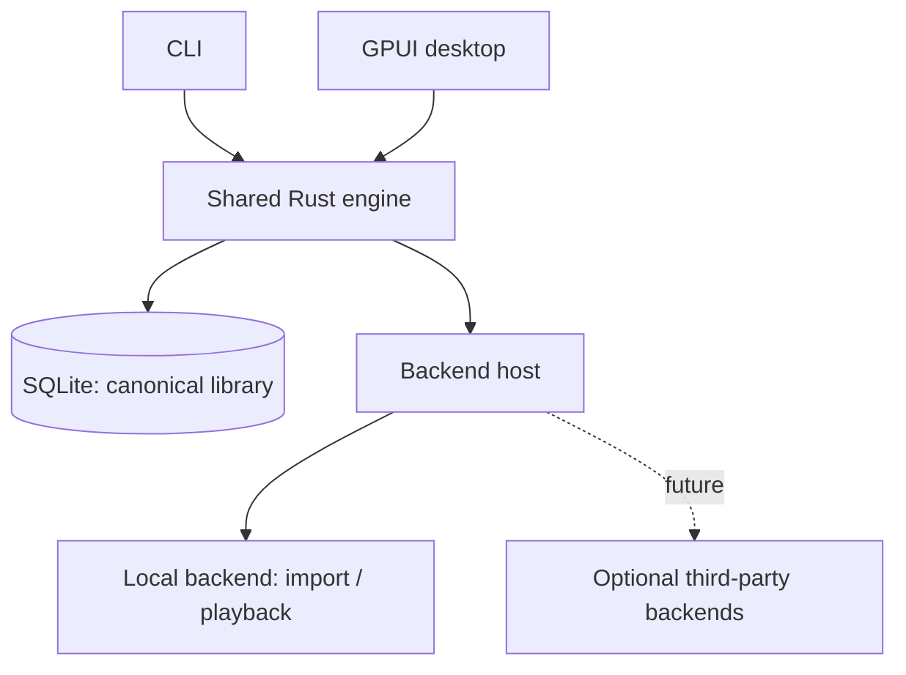
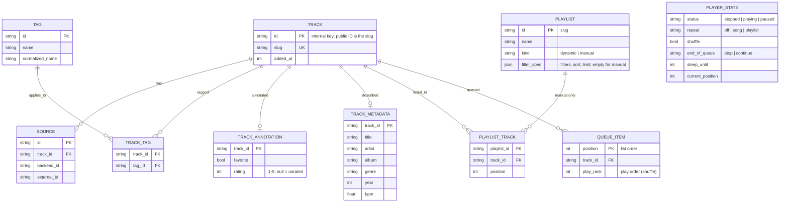

# Weave

**Rust · SQLite · GPUI**

## Goals

1. Play local music without accounts or network access.
2. Manage custom tags and source-neutral metadata.
3. Create dynamic playlists from structured filters.
4. Expose the same features through a CLI and GPUI desktop application.
5. Support capability-based backends, including optional third-party plugins in the future.

## Features and CLI

| Feature                 | CLI                                                                                                           | Behavior                                                                                                                                                                                                                                          |
| ----------------------- | ------------------------------------------------------------------------------------------------------------- | ------------------------------------------------------------------------------------------------------------------------------------------------------------------------------------------------------------------------------------------------- |
| Import music            | `weave-player import ~/Music`                                                                                 | Index audio files (recognized by content, not extension) without modifying them; prevent duplicate imports.                                                                                                                                       |
| List tracks             | `weave-player list [--sort FIELD [--desc]] [--limit N] [--page N --per-page N \| --all]`                      | Paged table (default 50 per page) with column titles, metadata, rating, favorite and tags; `--json` for structured output. Add `--show-ids` for the slug ID column.                                                                               |
| Sorting and limits      | `weave-player search --sort rating --desc --limit 20`                                                         | `--sort` is one of title, artist, album, genre, year, bpm, duration, rating, added; unknown values sort last in either direction. `--limit` keeps at most N matches before paging.                                                                |
| Favorites               | `weave-player favorite <track-id>...`, `weave-player unfavorite <track-id>...`                                | Mark or unmark tracks; `search --favorite` / `--not-favorite` filters on it.                                                                                                                                                                      |
| Ratings                 | `weave-player rate <track-id> 4`                                                                              | 1 to 5 stars; `0` clears. `search --rating-min 4` (and `--rating-max`) filter; unrated tracks never match a bound.                                                                                                                                |
| Play                    | `weave-player play <track-id>`                                                                                | Replace the queue with this track and start it (session state; audio output arrives in 0.a4).                                                                                                                                                     |
| Playback controls       | `weave-player pause`, `resume`, `stop`, `next`, `prev`                                                        | Control the playback session. `next` starts an idle queue; `resume` also restarts the current track after a stop.                                                                                                                                 |
| Current track           | `weave-player now`                                                                                            | Show status, current track, queue position, shuffle, repeat, end-of-queue mode and sleep timer.                                                                                                                                                   |
| Add tags                | `weave-player add --tag bachata`                                                                              | Tag the current track.                                                                                                                                                                                                                            |
| Add tags to track       | `weave-player add <track-id> --tag bachata,90s`                                                               | Add multiple tags, without duplicates.                                                                                                                                                                                                            |
| Remove tags             | `weave-player remove <track-id> --tag bachata`                                                                | Remove tag associations.                                                                                                                                                                                                                          |
| Show tags               | `weave-player tags <track-id>`                                                                                | List a track's custom tags.                                                                                                                                                                                                                       |
| Match all tags          | `weave-player search --tag-all bachata,90s`                                                                   | Require every tag.                                                                                                                                                                                                                                |
| Match any tags          | `weave-player search --tag-any bachata,zouk`                                                                  | Require at least one tag.                                                                                                                                                                                                                         |
| Exclude tags            | `weave-player search --tag-none remix,live`                                                                   | Exclude tracks with any specified tag.                                                                                                                                                                                                            |
| BPM range               | `weave-player search --bpm-min 90 --bpm-max 140`                                                              | Inclusive bounds; unknown BPM does not match.                                                                                                                                                                                                     |
| Combined filters        | `weave-player search --tag-all bachata --tag-none live --bpm-min 90`                                          | Apply every provided filter group.                                                                                                                                                                                                                |
| Metadata search         | `weave-player search --artist "Romeo Santos" --year-min 1990`                                                 | Filter by indexed metadata (title, artist, album, genre, year). Results are paged like `list`.                                                                                                                                                    |
| Create dynamic playlist | `weave-player playlist create "Bachata 90s" --description "Slow" --tag-all bachata,90s --sort bpm --limit 50` | Save filters, sort and limit, not track membership.                                                                                                                                                                                               |
| Create manual playlist  | `weave-player playlist create "Road trip" --manual`                                                           | An ordered list of tracks you choose.                                                                                                                                                                                                             |
| Edit manual playlist    | `weave-player playlist add "Road trip" <track-id>...`, `playlist remove ...`                                  | Append (skipping duplicates) or remove tracks; only manual playlists.                                                                                                                                                                             |
| Show playlist           | `weave-player playlist show "Bachata 90s"`                                                                    | Manual: tracks in saved order. Dynamic: evaluate the saved filters, sort and limit.                                                                                                                                                               |
| Update playlist         | `weave-player playlist update "Bachata 90s" --bpm-min 90`                                                     | Change specified filters of a dynamic playlist; retain others.                                                                                                                                                                                    |
| Play playlist           | `weave-player playlist play "Bachata 90s" [--append]`                                                         | Replace the queue with the playlist's current tracks and start it, or add them to the end.                                                                                                                                                        |
| List playlists          | `weave-player playlist list`                                                                                  | Table of NAME, DESCRIPTION, TYPE (`dynamic` or `manual`) and RULESET.                                                                                                                                                                             |
| Show queue              | `weave-player queue show`                                                                                     | Numbered queue with the current track marked.                                                                                                                                                                                                     |
| Queue tracks            | `weave-player queue add <track-id>... [--playlist NAME] [--next]`                                             | Append to the queue, or insert right after the current track with `--next`.                                                                                                                                                                       |
| Manage queue            | `weave-player queue remove <pos>...`, `queue move <from> <to>`, `queue jump <pos>`, `queue clear`             | Positions are 1-based as shown by `queue show`. The queue and its position persist between runs.                                                                                                                                                  |
| Shuffle                 | `weave-player shuffle on`                                                                                     | Play the queue in random order, current track first; each track plays once per round.                                                                                                                                                             |
| Repeat                  | `weave-player repeat off\|song\|playlist`                                                                     | `song` replays the current track when it ends (skipping still moves on); `playlist` loops the whole queue.                                                                                                                                        |
| End of queue            | `weave-player queue end stop\|continue`                                                                       | `stop` ends playback; `continue` appends similar tracks (shared tags, BPM near the queue's average) and keeps going.                                                                                                                              |
| Sleep timer             | `weave-player sleep 30m`, `weave-player sleep 30m --stop-after`, `weave-player sleep off`                     | Stop playback after a delay (`45s`, `30m`, `1h30m`). With `--stop-after`, a delay that runs out during a track lets that track finish and stops after it, instead of cutting it off.                                                              |
| Watch the session       | `weave-player watch [--interval 1s] [--for 1h]`                                                               | Optional foreground host that applies the sleep timer on time (it sleeps until the deadline, not just until the next command) and reports session changes; run it in a terminal, with `&`, or as a user service. Nothing starts it automatically. |
| List backends           | `weave-player backend list`                                                                                   | Show registered backends and capabilities.                                                                                                                                                                                                        |
| Inspect backend         | `weave-player backend show local`                                                                             | Show capabilities and availability.                                                                                                                                                                                                               |

### Output conventions

- Paging uses `--page` and `--per-page`; `--limit` is the cap on matches.
- Tables omit the long slug IDs by default; the global `--show-ids` flag adds a leading `ID` column to every table
  (`list`, `search`, `playlist list`, `playlist show`) and to `playlist create|update` output.
- `--json` always includes IDs.

### Filter conventions

- Filter groups combine with AND, and empty groups do not restrict results.
- Tag lists ignore blank entries and duplicates and match case-insensitively while keeping their display spelling.
- Ranges are inclusive, inverted or out-of-domain bounds are rejected, and tracks with an unknown value never match a bound.
- Text fields match as case-insensitive substrings.
- Results follow the requested sort (default artist, album, title) with unknown values last, and a limit applies before paging.
- Updating a saved filter changes only what is specified.
- Filters are typed parameters bound to SQL, not an expression language, and are shared by the CLI, the GUI and saved playlists.

## Technical design

### Architecture



- The engine owns track identity, tags, filters, playlists, and metadata overrides.
- Frontends call the engine API; they never directly modify its database.
- Start in-process. Add IPC only when concurrent clients or shared playback require it.
- Local files are never rewritten, moved, or deleted without explicit permission.

### Data model



- A track's identity is independent of filesystem paths and service IDs.
- Every public ID is a slug; see [Identifiers](#identifiers). Tracks and playlists store theirs as `slug`/`id` columns.
- Descriptive metadata (title, artist, album, album artist, genre, composer, year, track/disc number, duration, BPM) lives in an indexed `TRACK_METADATA` table (one row per track, with lowercased copies for filtering and ordering); `TRACK` holds identity only.
- A track may have multiple sources.
- Dynamic playlists persist filters (with sort and limit) and resolve membership on demand; manual playlists persist an ordered list of tracks.
- Favorites and ratings live in `TRACK_ANNOTATION`, apart from source-derived metadata, so enrichment and sync never overwrite them.
- The play queue and player state are single-row/single-queue tables (`QUEUE_ITEM`, `PLAYER_STATE`), written whole in one transaction after every operation.
- Until 0.1 the schema is a single squashed migration; older databases are rejected (delete and re-import). After 0.1 migrations are append-only.
- Use migrations, transactions, and indexes for tags and source mappings.

### Playback session

The queue, cursor and modes are an engine feature (`weave_core::Queue`, orchestrated by `Library`), shared by the CLI
and the future GUI. 0.a3 covers the state and rules; actual audio output arrives with the local playback backend in
0.a4, which will follow this state and report when a track ends (`Library::track_ended`).

- **No background process.** The session is persisted after every operation, so separate `weave-player` runs share
  it.
- **Sleep timer:** a stored deadline, checked whenever the session is read or changed (any command that touches it)
  and at every track change. Once it has passed, a plain timer stops playback (the position is kept) and is cleared.
  A `--stop-after` timer does not cut the track off: it schedules a stop for the end of the track that is playing.
  - Whenever a track starts (play, next, previous, jump, a track ending, resume after a stop, removing the current
    track), if the timer would come due before that track ends, the engine schedules the stop right then
    (`stop_after_track`). If not, the timer is left alone and checked again at the next track change.
  - The scheduled stop belongs to the current track: when that track ends by itself, playback stops there and the
    next track never starts (this also beats repeat-song). Skipping keeps it for the new current track; `stop` or a
    new `sleep` request clears it.
  - If the track's duration is unknown the engine cannot tell in advance, so the timer is handled when its deadline
    passes (a stop is scheduled then) or at the next track change.
  - A timer coming due while paused never stops the track mid-way; it waits for the track to finish.
  - **Timers need a host.** Short-lived commands cannot hold a timer, so a plain timer only takes effect the next time
    something reads the session unless a long-running host is waiting for the deadline. `Library::next_wakeup()` says how
    long until the session next needs attention; a host sleeps that long (and re-checks every second or so, since other
    commands change the session), then calls `session()`, which applies the timer. `weave-player watch` is that host
    today and the audio player in 0.a4 will be the same kind of host. It is optional (no mandatory background
    services); without one the behavior above still holds, just evaluated lazily.
  - Session changes are read-modify-write without a cross-process lock, so a command racing the watcher in the same
    few milliseconds could overwrite one of the two updates.
- **Queue:** an ordered list that may contain duplicates, plus a play order. Without shuffle the play order is the
  list order. `queue add --next` inserts right after the current track in both orders. Removing the current track
  moves to what would have played next. Positions in commands are 1-based.
- **Shuffle:** a random permutation with the current track first, so each track plays once per round. Tracks added
  while shuffled land randomly among those still to come. With repeat-playlist, each new round is reshuffled and does
  not start with the track that just played.
- **Repeat:** `song` replays the current track when it ends but not when the user skips; `playlist` loops the queue;
  `previous` at the start wraps while looping.
- **End of queue:** `stop` stops on the last track. `continue` builds a filter from the last 20 queued tracks
  (their most common tags, and the average BPM +-10%, at least +-5), takes matching tracks that are not already queued,
  ranks them by shared tags (weighted by how common each tag is in the queue), then by BPM distance, and appends up to 5. Without usable tags or BPM, or with no candidates, it stops.
- Transport commands that make no sense in the current state (pausing when nothing plays) fail with exit code 4 and
  change nothing.

### Identifiers

Every ID that a user, script, frontend or plugin sees or types is a **slug**: lowercase, readable and stable.
Internal surrogate keys (the track UUID, source and tag row IDs) exist only inside the database and are never shown,
returned by the engine API, printed by the CLI or accepted as the documented way to address something.

| Thing           | Slug                                | Example                                  |
| --------------- | ----------------------------------- | ---------------------------------------- |
| Track           | `artist[-album]-title-source`       | `romeo-santos-propuesta-indecente-local` |
| Playlist        | name                                | `bachata-90s`                            |
| Backend         | chosen by the backend               | `local`, `spotify`                       |
| Future entities | derived from their name, same rules |                                          |

Rules:

- Lowercase letters and digits of any script plus `-`; apostrophes are dropped, `&` becomes `and`, any other run of
  characters becomes one `-`; no leading or trailing `-`; each part is capped at 48 characters.
- Unknown artist → `unknown`; empty title → `untitled`; empty playlist name → `playlist`; album omitted when absent.
  A track's `source` is its first source's backend ID.
- Slugs are assigned once, unique (`-2`, `-3` on collision) and never change when metadata or names are edited.
- Lookups normalize their input the same way, so `Bachata 90s` and `BACHATA-90S` find `bachata-90s`. An exact name
  match wins over a slug match.
- New entities get a slug-based ID from the start; a backend's `id()` must itself be a slug (tested).
- Slugs are safe in URLs, shells and SQL literals, and queries are parameterized regardless.

### Backend contract

```rust
pub trait Backend: Send + Sync {
    fn id(&self) -> &str;
    fn capabilities(&self) -> Vec<CapabilityDescriptor>;
}
```

| Capability group | Examples                 |
| ---------------- | ------------------------ |
| Catalog          | Search, browse           |
| Library          | Read, write, synchronize |
| Metadata         | Read, enrich             |
| Playback         | Stream, control          |
| Playlists        | Read, write              |
| Assets           | Lyrics, artwork          |

- Each advertised capability has separately typed operations.
- Track _supported_, _authorized_, and _currently available_ capabilities.
- Backends cannot modify canonical SQLite tables directly.
- The bundled `local` backend uses the same contract as future external backends.
- Begin with registered Rust implementations; defer WASM/native ABI/subprocess plugin decisions.

### Workspace

```text
weave/
├── crates/
│   ├── core/           # Types, filters, backend contracts
│   ├── engine/         # Library, playlists, playback session orchestration
│   └── storage/        # SQLite, migrations
├── backends/
│   └── local/          # File import and playback
├── apps/
│   ├── cli/
│   └── desktop/        # GPUI
└── docs/
    ├── goals.md
    ├── agents.md
    └── credits.md
```

## Milestones

| Phase | Deliverable                                                                                                                                                      |
| ----- | ---------------------------------------------------------------------------------------------------------------------------------------------------------------- |
| 0.a1  | SQLite library, local import, tags, filters, CLI                                                                                                                 |
| 0.a2  | Static/dynamic playlists, sorting, limits, favorites, ratings                                                                                                    |
| 0.a3  | queueing, stop or continue at end of queue (similar tags and avg bpm), sleep timer, queue management and persistence, shuffle, repeat (this song, this playlist) |
| 0.a4  | MPRIS, local playback, synchronized lyrics                                                                                                                       |
| 0.a5  | Second backend, capability discovery, external plugin contract : Jellyfin integration - playback, playlist sync, save song source to source-neutral library      |
| 0.1   | Spotify integration                                                                                                                                              |
| 0.2   | GPUI library browser, tag editor, smart playlist builder                                                                                                         |

## Non-goals for MVP

Cloud accounts, public tag sharing, file rewriting, a general-purpose query DSL, and mandatory background services.

See [CONTRIBUTING.md](CONTRIBUTING.md) to build and run it locally, and [credits.md](credits.md).
