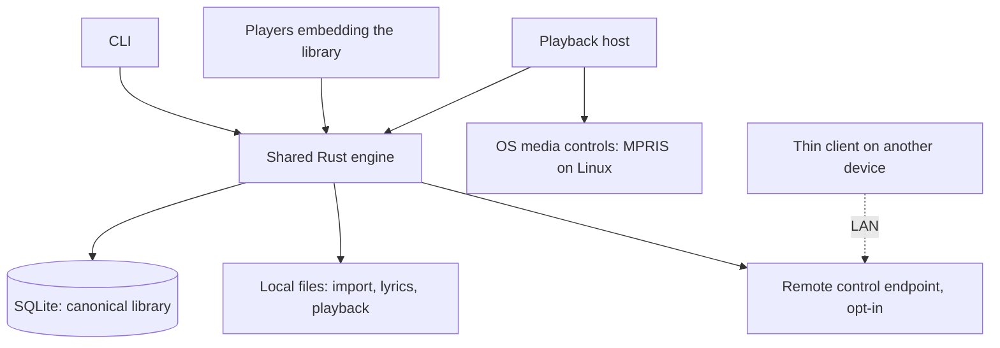
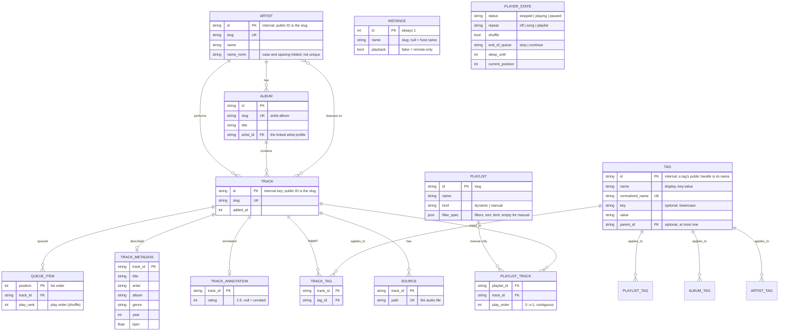

# Weave

**Rust · SQLite · GPUI**

## Why

I want to organise my own music on my own terms. So Weave lets you invent tags, with an optional key and as many levels as you like, and build dynamic playlists from them: a dynamic playlist is a saved query over your tags, so it stays current as you tag more music.

The tags are yours: `mood:romantic`, `lang:spanish`, `energy:high`, `wedding`. Keys and values are free text, and a parent tag reaches its children, so `lang:romance` can hold `lang:spanish` and `lang:french`. Mood plus language is the combination I started this project for, and any other mix works the same way.

Two things come with the track and need no tagging: the genre, which import reads from the files as a `genre:` tag that you can refine into subgenres, and the beat, the track's BPM, with `--bpm-min` and `--bpm-max`. Everything else in Weave, from the artist and album profiles to the queue and the remote control, serves that.

## Goals

1. Play local music without accounts or network access. Everything runs on your own machines: no cloud accounts and no third-party streaming services (no Spotify, no Jellyfin).
2. Organise on your own terms with tags you invent (`mood:romantic`, `lang:spanish`, `energy:high`, any key and any value, nested as deep as you like), together with the genre and the track's BPM, and show the shape of your own library: tracks, the artists and albums they belong to, and how those relate. Tags go on all of them.
3. Create dynamic playlists from structured filters over those tags, such as romantic Spanish tracks under 100 BPM.
4. Expose the same features through a CLI and as an embeddable library that other players (GUI frontends are separate projects) embed.
5. Control and watch one instance from another over your own network. A phone can be a thin client of the engine running on your desktop (see the queue, play, pause, skip, add tracks), even though the two libraries hold different music. There are two modes only: everything local, or a thin client of another instance.

## Features and CLI

| Feature                        | CLI                                                                                                                           | Behavior                                                                                                                                                                                                                                                                                                                                                                                                                                                                                       |
| ------------------------------ | ----------------------------------------------------------------------------------------------------------------------------- | ---------------------------------------------------------------------------------------------------------------------------------------------------------------------------------------------------------------------------------------------------------------------------------------------------------------------------------------------------------------------------------------------------------------------------------------------------------------------------------------------- |
| Import music                   | `weave-player import ~/Music`                                                                                                 | Index audio files (recognized by content, not extension) without modifying them; prevent duplicate imports. Every artist it finds is new, never attached to one already in the library (the same name can be a different person), and `A feat. B` in the artist or title makes B a featured artist of its own. Afterwards, in a terminal, it asks about new artists, albums and tracks that look like existing ones and merges only what you say. `--disable-dedup-check` skips the questions. |
| List tracks                    | `weave-player list [--sort FIELD [--desc]] [--limit N] [--page N --per-page N \| --all]`                                      | Paged table (default 50 per page) with column titles, metadata, rating and tags; `--json` for structured output. Add `--show-ids` for the slug ID column.                                                                                                                                                                                                                                                                                                                                      |
| Sorting and limits             | `weave-player search --sort rating --desc --limit 20`                                                                         | `--sort` is one of title, artist, album, genre, year, bpm, duration, rating, added; unknown values sort last in either direction. `--limit` keeps at most N matches before paging.                                                                                                                                                                                                                                                                                                             |
|                                |                                                                                                                               |                                                                                                                                                                                                                                                                                                                                                                                                                                                                                                |
| Match all tags                 | `weave-player search --tag-all mood:romantic,lang:spanish`                                                                    | Require every tag.                                                                                                                                                                                                                                                                                                                                                                                                                                                                             |
| Match any tags                 | `weave-player search --tag-any genre=bachata,zouk`                                                                            | Require at least one tag.                                                                                                                                                                                                                                                                                                                                                                                                                                                                      |
| Exclude tags                   | `weave-player search --tag-exclude mood:sad,live`                                                                             | Exclude tracks with any specified tag.                                                                                                                                                                                                                                                                                                                                                                                                                                                         |
| BPM range                      | `weave-player search --bpm-min 90 --bpm-max 140`                                                                              | Inclusive bounds; unknown BPM does not match.                                                                                                                                                                                                                                                                                                                                                                                                                                                  |
| Metadata search                | `weave-player search --artist "Romeo Santos" --year-min 1990`                                                                 | Filter by indexed metadata (title, artist, album, genre, year). Results are paged like `list`.                                                                                                                                                                                                                                                                                                                                                                                                 |
| Combined filters               | `weave-player search --tag-all lang:spanish,mood:romantic --bpm-max 100`                                                      | Apply every provided filter group.                                                                                                                                                                                                                                                                                                                                                                                                                                                             |
|                                |                                                                                                                               |                                                                                                                                                                                                                                                                                                                                                                                                                                                                                                |
| Add tags                       | `weave-player add --tag mood:romantic`                                                                                        | Tag the current track.                                                                                                                                                                                                                                                                                                                                                                                                                                                                         |
| Add tags to track              | `weave-player add <track-id> --tag mood:romantic,lang:spanish`                                                                | Add multiple tags, without duplicates.                                                                                                                                                                                                                                                                                                                                                                                                                                                         |
| Remove tags                    | `weave-player remove <track-id> --tag mood:party`                                                                             | Remove tag associations.                                                                                                                                                                                                                                                                                                                                                                                                                                                                       |
| Show tags                      | `weave-player tags <track-id>`                                                                                                | List a track's custom tags.                                                                                                                                                                                                                                                                                                                                                                                                                                                                    |
| Track detail                   | `weave-player track <track-id>`                                                                                               | Everything about a track: metadata, tags, rating, file, the artist and album it is linked to, its playlists and its queue positions. `--json` for all of it.                                                                                                                                                                                                                                                                                                                                   |
| Artist profile                 | `weave-player artist <artist-id>`                                                                                             | Tags, track count and length, years, BPM range, ratings, when it entered the library, its genres and most common tags, the tracks it is featured on, and its albums.                                                                                                                                                                                                                                                                                                                           |
| Album profile                  | `weave-player album <album-id>`                                                                                               | The linked artist, tags, the same figures, and the tracklist in disc and track order.                                                                                                                                                                                                                                                                                                                                                                                                          |
| List artists / albums          | `weave-player artist list [--tag-any genre=latin]`, `weave-player album list [--artist <id>]`                                 | By name; the `--tag-*` filters apply to the tags on the artists or albums themselves (a parent tag reaches its children). `--show-ids` adds the ID column to artists; albums always show theirs.                                                                                                                                                                                                                                                                                               |
| Tag artists, albums, playlists | `weave-player artist tag <id> --add legend,genre:bachata --remove x`, `album tag`, `playlist tag`                             | The same tags (one vocabulary, one tree) as on tracks.                                                                                                                                                                                                                                                                                                                                                                                                                                         |
| Find duplicates                | `weave-player dedup list [artist\|album\|track]`, `weave-player dedup ask`                                                    | Artists, albums or tracks that look alike: artists by name (the very same name too), albums by title and artist, tracks by title, artist and length. `ask` goes through them like import does. Suggestions only.                                                                                                                                                                                                                                                                               |
| Merge or separate              | `weave-player dedup merge <kind> <from> <into>`, `weave-player dedup separate <kind> <a> <b>`                                 | Merge folds one into the one to keep: artists move tracks, featured credits, albums and tags; albums move tracks and tags; tracks move their files (extra files stay attached), tags, a missing rating, queue spots and playlist places. Separate records "different" so the pair is not suggested again.                                                                                                                                                                                      |
| Split an artist                | `weave-player artist split <id> --album a,b --track c --slug new-id`                                                          | For people who share a name: a new artist (same name unless `--name`) takes the given tracks and albums, and the two are marked as different.                                                                                                                                                                                                                                                                                                                                                  |
| Change an artist's ID          | `weave-player artist slug <id> <new-id>`                                                                                      | An explicit edit of the public ID; album and track IDs made from the old name do not change.                                                                                                                                                                                                                                                                                                                                                                                                   |
| Link an album to an artist     | `weave-player album link <album> <artist>`, `weave-player album unlink <album>`                                               | An album is linked at import to its album artist, else its track artist; link fixes it by hand.                                                                                                                                                                                                                                                                                                                                                                                                |
| Search by keyed tags           | `weave-player search --tag-any genre=bachata,zouk --tag-all lang=spanish --bpm-min 90 --bpm-max 120`                          | `--tag-all`, `--tag-any` and `--tag-exclude` take bare names (`bachata,90s`) or `KEYS=VALUES` (`genre=bachata,sals`, `genre,style=salsa`); repeat a flag for more clauses. A tag matches its child tags too; `genre==bachata` or `=genre:bachata` matches that tag only.                                                                                                                                                                                                                       |
| Create tag                     | `weave-player tag create genre:bachata-sensual --parent genre:bachata`                                                        | Keyed (`genre:x`) or unkeyed (`practice`); at most one parent.                                                                                                                                                                                                                                                                                                                                                                                                                                 |
| Reparent tag                   | `weave-player tag parent <tag> <parent>` / `--clear`                                                                          | Changes what the parent matches, never track assignments. Self-parenting and cycles are rejected.                                                                                                                                                                                                                                                                                                                                                                                              |
| List / delete tags             | `weave-player tag list` / `tag delete <tag> --detach-children\|--delete-children`                                             | Deleting a tag requires choosing what happens to its children.                                                                                                                                                                                                                                                                                                                                                                                                                                 |
| Ratings                        | `weave-player rate <track-id> 4`                                                                                              | 1 to 5 stars; `0` clears. `search --rating-min 4` (and `--rating-max`) filter; unrated tracks never match a bound.                                                                                                                                                                                                                                                                                                                                                                             |
|                                |                                                                                                                               |                                                                                                                                                                                                                                                                                                                                                                                                                                                                                                |
| Create dynamic playlist        | `weave-player playlist create "Slow Spanish nights" --tag-all mood:romantic,lang:spanish --bpm-max 100 --sort bpm --limit 50` | Save filters, sort and limit, not track membership.                                                                                                                                                                                                                                                                                                                                                                                                                                            |
| Create manual playlist         | `weave-player playlist create "Road trip" --manual`                                                                           | An ordered list of tracks you choose.                                                                                                                                                                                                                                                                                                                                                                                                                                                          |
| Edit manual playlist           | `weave-player playlist add "Road trip" <track-id>...`, `playlist remove ...`, `playlist move "Road trip" 8 1`                 | Append (skipping duplicates), remove or move tracks; only manual playlists. Removing closes the gaps in the play order.                                                                                                                                                                                                                                                                                                                                                                        |
| Show playlist                  | `weave-player playlist show "Bachata 90s"`                                                                                    | A playlist's tracks with their play order (`#`, 1-based, continuing across pages; `--json` has `play_order`). A dynamic playlist is evaluated from its saved filters, sort and limit.                                                                                                                                                                                                                                                                                                          |
| Update playlist                | `weave-player playlist update "Bachata 90s" --bpm-min 90`                                                                     | Change specified filters of a dynamic playlist; retain others.                                                                                                                                                                                                                                                                                                                                                                                                                                 |
| List playlists                 | `weave-player playlist list`                                                                                                  | Table of NAME, DESCRIPTION, TYPE (`dynamic` or `manual`) and RULESET.                                                                                                                                                                                                                                                                                                                                                                                                                          |
|                                |                                                                                                                               |                                                                                                                                                                                                                                                                                                                                                                                                                                                                                                |
| Play a track                   | `weave-player play track <track-id>`                                                                                          | Replace the queue with this one track and start it, in list order (shuffle off); starts the playback host if none runs.                                                                                                                                                                                                                                                                                                                                                                        |
| Play a playlist                | `weave-player play playlist "Bachata 90s" [--shuffle]`                                                                        | Replace the queue with the playlist's current tracks (manual or dynamic) in the playlist's play order and start it. `--shuffle` turns shuffle on and starts from a random track; without it the playlist plays in list order.                                                                                                                                                                                                                                                                  |
| Random play                    | `weave-player play random --tag-all lang:spanish --bpm-min 90`                                                                | Play everything matching the filters (the whole library with none) in random order from a random track, with shuffle on. Takes the same filters, sort and limit as `search`.                                                                                                                                                                                                                                                                                                                   |
| Playback controls              | `weave-player pause`, `resume`, `stop`, `next`, `prev`                                                                        | Control the playback session. `next` starts an idle queue; `resume` also restarts the current track after a stop.                                                                                                                                                                                                                                                                                                                                                                              |
| Current track                  | `weave-player now`                                                                                                            | Show status, current track and time, volume, queue position, shuffle, repeat, end-of-queue mode, sleep timer and whether the host runs.                                                                                                                                                                                                                                                                                                                                                        |
| Seek                           | `weave-player seek 1:30`, `seek 90s`, `seek +10s`, `seek -10s`                                                                | Jump within the current track, absolute or relative to the current position.                                                                                                                                                                                                                                                                                                                                                                                                                   |
| Volume                         | `weave-player volume 80`                                                                                                      | Set the volume, 0 to 100; without a value shows it.                                                                                                                                                                                                                                                                                                                                                                                                                                            |
|                                |                                                                                                                               |                                                                                                                                                                                                                                                                                                                                                                                                                                                                                                |
| Show queue                     | `weave-player queue show`                                                                                                     | Numbered queue with the current track marked.                                                                                                                                                                                                                                                                                                                                                                                                                                                  |
| Queue tracks                   | `weave-player queue add <track-id>... [--playlist NAME] [--next]`                                                             | Append tracks, and/or a playlist's current tracks (manual or dynamic) as plain tracks, to the queue, or insert them right after the current track with `--next`. Whatever started the queue, it is the same now-playing queue.                                                                                                                                                                                                                                                                 |
| Manage queue                   | `weave-player queue remove <pos>...`, `queue move <from> <to>`, `queue jump <pos>`, `queue clear`                             | Positions are 1-based as shown by `queue show`. The queue and its position persist between runs.                                                                                                                                                                                                                                                                                                                                                                                               |
| Shuffle mode                   | `weave-player shuffle on\|off`                                                                                                | Play the current queue in random order, current track first; each track plays once per round.                                                                                                                                                                                                                                                                                                                                                                                                  |
| Repeat                         | `weave-player repeat off\|song\|playlist`                                                                                     | `song` replays the current track when it ends (skipping still moves on); `playlist` loops the whole queue.                                                                                                                                                                                                                                                                                                                                                                                     |
| End of queue                   | `weave-player queue end stop\|continue`                                                                                       | `stop` ends playback; `continue` appends similar tracks (shared tags, BPM near the queue's average) and keeps going.                                                                                                                                                                                                                                                                                                                                                                           |
| Sleep timer                    | `weave-player sleep 30m`, `weave-player sleep 30m --stop-after`, `weave-player sleep off`                                     | Stop playback after a delay (`45s`, `30m`, `1h30m`). With `--stop-after`, a delay that runs out during a track lets that track finish and stops after it, instead of cutting it off.                                                                                                                                                                                                                                                                                                           |
|                                |                                                                                                                               |                                                                                                                                                                                                                                                                                                                                                                                                                                                                                                |
| Lyrics                         | `weave-player lyrics [<track-id>] [--follow]`                                                                                 | Show a track's lyrics (the current track by default), marking the current line when synchronized; `--follow` prints each line as it begins while the session plays.                                                                                                                                                                                                                                                                                                                            |
| Playback host                  | `weave-player host`, `weave-player quit`                                                                                      | The resident process that plays audio, registers with the OS media controls (MPRIS on Linux) and applies timers. Commands that start playback launch it if needed (`--no-host` or `WEAVE_NO_HOST=1` disables that); `host` runs it in the foreground and `quit` stops it.                                                                                                                                                                                                                      |
|                                |                                                                                                                               |                                                                                                                                                                                                                                                                                                                                                                                                                                                                                                |
| Show instance                  | `weave-player instance show`                                                                                                  | The name this instance goes by on the network and whether it may play audio.                                                                                                                                                                                                                                                                                                                                                                                                                   |
| Name instance                  | `weave-player instance name "Living Room"`                                                                                    | Stored as a slug (`living-room`); defaults to the host name.                                                                                                                                                                                                                                                                                                                                                                                                                                   |
| Allow or stop playback         | `weave-player instance playback on\|off`                                                                                      | `off` makes the instance remote-only: it keeps its library and queue and can be controlled, but never makes sound (no host is started and an embedded `Player` refuses to start).                                                                                                                                                                                                                                                                                                              |

### Output conventions

- Paging uses `--page` and `--per-page`; `--limit` is the cap on matches.
- Tables omit the long slug IDs by default; the global `--show-ids` flag adds a leading `ID` column to every table (`list`, `search`, `playlist list`, `playlist show`) and to `playlist create|update` output.
- `--json` always includes IDs.

### Filter conventions

- Filter groups combine with AND, and empty groups do not restrict results.
- Tag lists ignore blank entries and duplicates and match case-insensitively while keeping their display spelling.
- A tag is an optional key plus a value (`genre:bachata`, `practice`); the colon is syntax, not hierarchy. Each tag has zero or one parent. Assignments are explicit and flat; `has` (default) matches the tag and its descendants, `has_exact` (`=` prefix, `==` in keyed flags) only explicit assignments, and exclude removes the tag and its descendants.
- Importing a track assigns its genre as a `genre:` tag; that is the only thing import turns into a tag. Once imported it is an ordinary tag: the library owns it, with no record of where it came from, and it is edited, removed and queried like any other. The TAGS column skips the genre tag that the GENRE column already shows. Re-imports skip known tracks, so they never touch existing tags.
- Tags are text. Numbers are the track's own columns: BPM and year have `--bpm-min/--bpm-max` and `--year-min/--year-max` (inclusive; an unknown value never matches), and ratings have `--rating-min/--rating-max`.
- Rule of thumb: tags hold the genre and the user's own descriptive tags, nothing else. Identifying data (title, artist, album) is not a tag, and neither is anything numeric (year, BPM, duration, rating).
- Title, artist and album identify a track and are not tags: `--title`, `--artist` and `--album` are case-insensitive substring filters. The genre is filtered through its tag (`--tag-any genre=…`).
- Ranges are inclusive, inverted or out-of-domain bounds are rejected, and tracks with an unknown value never match a bound.
- Text fields match as case-insensitive substrings.
- Results follow the requested sort (default artist, album, title) with unknown values last, and a limit applies before paging.
- Updating a saved filter changes only what is specified.
- Filters are typed parameters bound to SQL, not an expression language, and are shared by the CLI, the GUI and saved playlists.

## Technical design

### Architecture



- The engine owns track identity, tags, filters, playlists, and metadata overrides.
- Frontends call the engine API; they never directly modify its database.
- Every instance owns its library. Instances are independent: libraries are never synced or merged, and a thin client holds no library at all (see [Remote control](#remote-control)).
- Commands edit the persisted session; a resident playback host follows it (see [Playback session](#playback-session) and `docs/adr/0001-playback-host.md`). Add IPC only if polling latency becomes a problem.
- Local files are never rewritten, moved, or deleted without explicit permission.

### Data model



- A track's identity is independent of filesystem paths and service IDs.
- Every public ID is a slug; see [Identifiers](#identifiers). Tracks and playlists store theirs as `slug`/`id` columns.
- Descriptive metadata (title, artist, album, album artist, genre, composer, year, track/disc number, duration, BPM) lives in an indexed `TRACK_METADATA` table (one row per track, with lowercased copies for filtering and ordering); `TRACK` holds identity only.
- A track has one source, its local file. `SOURCE` keeps that link apart from the track's identity, so identity never depends on a path. Two instances that both hold the same song have two unrelated tracks.
- Every playlist has a canonical order. A manual playlist stores an integer play order per track (contiguous from 0, shown 1-based, renumbered when tracks are removed and changed by `playlist move`), like a queue's positions. A dynamic playlist derives it from its saved sort (default artist, album, title) with a fixed tiebreak, so the same filter always yields the same order. Playing or queueing a playlist uses that order.
- Dynamic playlists persist filters (with sort and limit) and resolve membership on demand; manual playlists persist an ordered list of tracks.
- Artists and albums are entities of their own (`ARTIST`, `ALBUM`), linked from tracks, with a slug ID, a profile and tags. Import never attaches a track to an artist already in the library: it makes a new artist per name per run, because the same name can be different people, and a check afterwards asks about look-alikes, merging only on the user's word. Featured artists (`A feat. B`, read from the artist field or the title) are credits of their own on the track, linked to artists; the track's own artist is the primary. Title, artist and album text stay in the metadata columns, so identifying data is still not a tag.
- Duplicate checking is one mechanism for artists, albums and tracks: find things that look alike, merge or mark them different, and remember it. A track has one file, or several after duplicate tracks are merged (the oldest plays).
- Tags can be put on tracks, artists, albums and playlists: one vocabulary and one tree, with an assignment table per kind. A track filter only looks at the tags on tracks; there is no inheritance from its artist or album.
- Ratings live in `TRACK_ANNOTATION`, apart from source-derived metadata, so enrichment and sync never overwrite them.
- The play queue and player state are single-row/single-queue tables (`QUEUE_ITEM`, `PLAYER_STATE`), written whole in one transaction after every operation.
- Until 0.1 the schema is a single squashed migration; older databases are rejected (delete and re-import). After 0.1 migrations are append-only.
- Use migrations, transactions, and indexes for tags and the source link.

### Playback session

The queue, cursor and modes are an engine feature (`weave_core::Queue`, orchestrated by `Library`), shared by the CLI, the embedded player and any other player that embeds the library.

- **Playback host:** a resident process (`weave-player host`) that plays the session through the `Playback` trait (rodio for local files), registers with the OS media controls and applies timers. Commands only edit the persisted session (queue, status, seek requests, volume); the host polls it every 100 ms, starts a track when `start_seq` changes, seeks when `seek_seq` changes, tells the engine when a track ends (`Library::track_ended`) and publishes the real position about once a second. Commands that leave the session playing start a host if none runs (detached, logging to `<db>.host.log`); an exclusive lock on `<db>.host.lock` keeps it to one per library. A host started late resumes at the session's position. The library and queue work with no host at all; nothing plays.
- **Unplayable tracks** (no local file, or an undecodable one) are skipped with a logged error, and a queue with nothing playable stops instead of looping.
- **Position:** the session stores an anchor (position at a unix time); while playing the position is the anchor plus the time since, so every command can show where playback is without asking the host.
- **Sleep timer:** a stored deadline, checked whenever the session is read or changed (any command that touches it) and at every track change. Once it has passed, a plain timer stops playback (the position is kept) and is cleared. A `--stop-after` timer does not cut the track off: it schedules a stop for the end of the track that is playing.
  - Whenever a track starts (play, next, previous, jump, a track ending, resume after a stop, removing the current track), if the timer would come due before that track ends, the engine schedules the stop right then (`stop_after_track`). If not, the timer is left alone and checked again at the next track change.
  - The scheduled stop belongs to the current track: when that track ends by itself, playback stops there and the next track never starts (this also beats repeat-song). Skipping keeps it for the new current track; `stop` or a new `sleep` request clears it.
  - If the track's duration is unknown the engine cannot tell in advance, so the timer is handled when its deadline passes (a stop is scheduled then) or at the next track change.
  - A timer coming due while paused never stops the track mid-way; it waits for the track to finish.
  - The host wakes at the deadline (`Library::next_wakeup()`) and applies it, so timers fire on time. Without a host they are applied the next time a command touches the session.
- **Media controls:** with the `media-controls` feature the player registers with the OS through souvlaki (its in-progress 1.0 branch); only Linux is wired so far. There that is MPRIS: `org.mpris.MediaPlayer2.weave`, showing the status, track (title, artist, album, length, and lyrics as `xesam:asText`), position, volume, shuffle and loop mode, and turning media keys, desktop widgets and `playerctl` into the same engine calls the CLI uses (play, pause, stop, next, previous, seek, set position, volume, shuffle, loop, quit). A second player for another library cannot take the name and says so. Souvlaki 1.0 sends a constant track id and signals `Seeked` whenever the position is pushed (once a second while playing).
- **Lyrics:** read from the audio file's neighbors and tags: a `.lrc` file next to the audio file, else lyrics in the file's tags. LRC is parsed in core: several timestamps per line, `[offset:]`, enhanced `<mm:ss.xx>` marks stripped, metadata tags ignored. Lyrics without timestamps are plain. The current line is the last one that has started.
- Session changes are read-modify-write without a cross-process lock, so two writers (a command and the host) in the same few milliseconds could overwrite one of the two updates.
- **One now-playing queue:** whatever starts it (`play track`, `play playlist`, `play random`), it is the same queue and works the same: tracks and playlists can be added to it, and its items moved, removed and jumped to. Starting something replaces the queue. A playlist or a search is a snapshot taken when it starts. Adding a playlist (`queue add --playlist`, manual or dynamic) appends its current tracks as plain tracks; the queue does not become that playlist's. Every `play` command sets shuffle explicitly: `play track` and `play playlist` turn it off, `play playlist --shuffle` and `play random` turn it on. Recommendations (`queue end continue`) append similar tracks when the queue runs out.
- **Queue:** an ordered list that may contain duplicates, plus a play order. Without shuffle the play order is the list order. `queue add --next` inserts right after the current track in both orders. Removing the current track moves to what would have played next. Positions in commands are 1-based.
- **Shuffle:** a random permutation with the current track first (and a shuffled queue starts at a random track), so each track plays once per round. Tracks added while shuffled land randomly among those still to come. With repeat-playlist, each new round is reshuffled and does not start with the track that just played.
- **Repeat:** `song` replays the current track when it ends but not when the user skips; `playlist` loops the queue; `previous` at the start wraps while looping.
- **End of queue:** `stop` stops on the last track. `continue` builds a filter from the last 20 queued tracks (their most common tags, and the average BPM +-10%, at least +-5), takes matching tracks that are not already queued, ranks them by shared tags (weighted by how common each tag is in the queue), then by BPM distance, and appends up to 5. Without usable tags or BPM, or with no candidates, it stops.
- Transport commands that make no sense in the current state (pausing when nothing plays) fail with exit code 4 and change nothing.

### Identifiers

Every ID that a user, script, frontend or remote client sees or types is a **slug**: lowercase, readable and stable. Internal surrogate keys (the track UUID, source and tag row IDs) exist only inside the database and are never shown, returned by the engine API, printed by the CLI or accepted as the documented way to address something.

| Thing           | Slug                                | Example                            |
| --------------- | ----------------------------------- | ---------------------------------- |
| Track           | `artist[-album]-title`              | `romeo-santos-propuesta-indecente` |
| Playlist        | name                                | `bachata-90s`                      |
| Instance        | its name                            | `living-room`                      |
| Future entities | derived from their name, same rules |                                    |

Rules:

- Lowercase letters and digits of any script plus `-`; apostrophes are dropped, `&` becomes `and`, any other run of characters becomes one `-`; no leading or trailing `-`; each part is capped at 48 characters.
- Unknown artist → `unknown`; empty title → `untitled`; empty playlist name → `playlist`; album omitted when absent.
- Slugs are assigned once, unique (`-2`, `-3` on collision) and never change when metadata or names are edited.
- Lookups normalize their input the same way, so `Bachata 90s` and `BACHATA-90S` find `bachata-90s`. An exact name match wins over a slug match.
- New entities get a slug-based ID from the start.
- Slugs are safe in URLs, shells and SQL literals, and queries are parameterized regardless.

### Library and CLI

Two separate artifacts are built from the workspace: the `weave` **library** (`cargo build -p weave`) and the `weave-player` **CLI** (`cargo build -p weave-player`). The library contains no CLI code or dependencies; the CLI depends on `weave` and nothing else in the workspace, so whatever the CLI can do, an embedding player can do.

- **`Library`** is a handle on one library database: tracks, tags, playlists, ratings, filters, the now-playing queue, lyrics, sleep timer. Several handles, in one or more processes, can be open at once; the session lives in the database.
- **`Player`** plays the session in the embedding process, on its own thread with its own connection: audio (`Audio::Device`, `Audio::Off`, or the embedder's own `Audio::Custom` output), the real position, advancing when a track ends, the sleep timer on time, and with `media-controls` the OS media controls. It reports typed `PlayerEvent`s on a channel. Dropping it stops it. Only one player runs per library across processes (a lock file), so an embedding app and the CLI's host exclude each other: the CLI keeps working against the same library, and the app's player does the playing.
- **Features**, none on by default: `audio`, `media-controls`, `sqlite-from-source`. The `weave::core` module has the domain types.
- Rust only, and unstable until 0.1. Wrapping it in a C ABI for non-Rust players is a possible later step.

### Local files

Weave plays and imports local files. `crates/local` scans them, reads their tags and lyrics and plays them (rodio, behind the `audio` feature). Nothing else supplies tracks: there are no backends, third-party plugins or streaming-service integrations.

- Local files are never rewritten, moved or deleted without explicit permission.

### Remote control

An **instance** is a full engine with its own library, queue and player. A **thin client** (a phone, a second computer) connects to an instance over the local network and controls it; nothing is copied between the two.

#### Instance identity and capabilities

- **Name:** every instance has a name, a slug that it advertises on the network and that clients show. It defaults to the host name and is changed with `instance name`. Implemented.
- **Capabilities:** an instance's owner decides what it does. `playback` (implemented) lets it make sound; with it off the instance is **remote-only**: it keeps a library and a queue and can be controlled, but never plays audio. A second capability, `serve`, will decide whether it accepts remote clients at all (off by default).
- Instance settings and client management are changed on the instance itself, never over the network.

#### What a client can do

- Everything the CLI can do to the instance it connects to: view the queue and session (status, position, volume), play, pause, seek, skip, jump, add or remove queue items, search and browse the instance's library and playlists, edit tags. Slugs and filters always refer to the instance being controlled and are resolved there.
- **Who plays:** the instance. Audio comes out of the machine that owns the files. A client does not stream or store music (it may later, but that is not part of this goal).
- **No sync:** a desktop and a phone running their own instances keep separate libraries. Connecting to the other one is how you use its music; there is no merge, no conflict resolution and no shared cloud state.
- **One engine API:** the remote surface exposes the `Library` operations and session events; it adds no filtering, queue or playlist logic of its own. Live updates (queue and position changes) are pushed to connected clients.

#### Registering and trusting clients

Being on the same network earns a device nothing. Discovery shows an instance's name and that is all; every other request needs a client the owner has registered.

- **Register:** only by an explicit action on the instance, with its owner present (`client pair`). It prints a single-use code (and a QR code for phones) that expires in a few minutes. The client presents it with a name and a public key of its own; the instance stores the client under a slug. Failed attempts are rate-limited.
- **Pin both ways:** at pairing the client records the instance's key fingerprint, so later connections reach the same instance and are encrypted. Every request is authenticated with the client's key, never a shared password.
- **Trust levels, per client:** `view` (see the queue, session and library) and `control` (also change the queue and playback, and edit tags and playlists). Registering and revoking clients, renaming the instance and switching capabilities are local-only and need no level because no client can reach them.
- **Review and revoke:** `client list` shows each client's name, level, when it was paired and when it was last seen; `client trust <name> view|control` changes the level; `client revoke <name>` takes effect at once and drops live connections. Revoked and unknown clients get no data and no hint of what exists.
- **Record:** the instance keeps a short log of what each client did, so a lost phone can be revoked with confidence.
- **Opt-in and private:** the endpoint is off by default, serves only the local network, and uses no accounts, relay servers or internet exposure.

#### Open questions, to settle with a spike before committing

Discovery (mDNS or a typed address), the transport (TLS with a pinned self-signed certificate, or a Noise handshake), the wire protocol (HTTP and JSON with a WebSocket or server-sent events for updates), and how a client keeps working when the instance goes to sleep.

### Workspace

```text
weave/
├── crates/
│   ├── weave/          # The library to embed: facade over the crates below + the embedded Player
│   ├── core/           # Types, filters, instance identity
│   ├── engine/         # Library, playlists, playback session orchestration
│   ├── local/          # File import, lyrics and playback
│   └── storage/        # SQLite, migrations
├── apps/
│   └── cli/            # weave-player: a frontend over the `weave` library only
└── docs/
    ├── goals.md
    ├── agents.md
    └── credits.md
```

## Milestones

| Phase | Deliverable                                                                                                                                                      |
| ----- | ---------------------------------------------------------------------------------------------------------------------------------------------------------------- |
| 0.a1  | SQLite library, local import, tags, filters, CLI                                                                                                                 |
| 0.a2  | Static/dynamic playlists, sorting, limits, ratings                                                                                                               |
| 0.a3  | queueing, stop or continue at end of queue (similar tags and avg bpm), sleep timer, queue management and persistence, shuffle, repeat (this song, this playlist) |
| 0.a4  | MPRIS, local playback, synchronized lyrics                                                                                                                       |
| 0.a5  | library/embedded build. Two separate build artifacts possible "library" and "cli"                                                                                |
| 0.a6  | Remote control spike and protocol: pairing, discovery, a command and event surface over the engine API                                                           |
| 0.a7  | Thin client: view and control the queue and library of another instance over the network                                                                         |

## Non-goals for MVP

Cloud accounts, third-party streaming services and backends (Spotify, Jellyfin), plugins, syncing or merging libraries between instances, public tag sharing, file rewriting and a general-purpose query DSL. GUI frontends should be a separate project that embed this library.

See [CONTRIBUTING.md](CONTRIBUTING.md) to build and run it locally, and [credits.md](credits.md).
