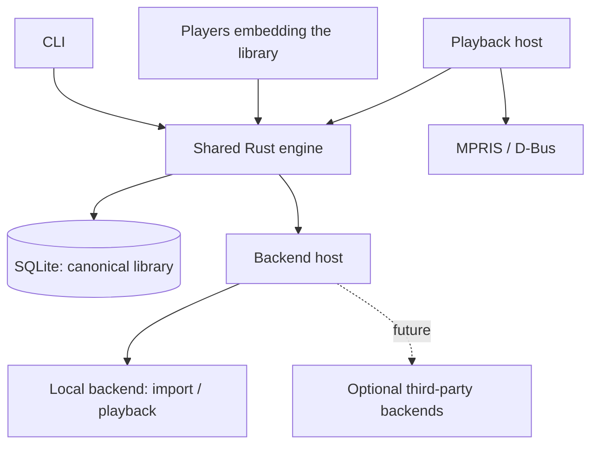
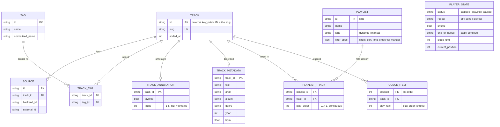

# Weave

**Rust · SQLite · GPUI**

## Goals

1. Play local music without accounts or network access.
2. Manage custom tags and source-neutral metadata.
3. Create dynamic playlists from structured filters.
4. Expose the same features through a CLI and as an embeddable library that other players (GUI frontends are separate projects) use as their backend.
5. Support capability-based backends, including optional third-party plugins in the future.

## Features and CLI

| Feature                 | CLI                                                                                                           | Behavior                                                                                                                                                                                                                         |
| ----------------------- | ------------------------------------------------------------------------------------------------------------- | -------------------------------------------------------------------------------------------------------------------------------------------------------------------------------------------------------------------------------- |
| Import music            | `weave-player import ~/Music`                                                                                 | Index audio files (recognized by content, not extension) without modifying them; prevent duplicate imports.                                                                                                                      |
| List tracks             | `weave-player list [--sort FIELD [--desc]] [--limit N] [--page N --per-page N \| --all]`                      | Paged table (default 50 per page) with column titles, metadata, rating, favorite and tags; `--json` for structured output. Add `--show-ids` for the slug ID column.                                                              |
| Sorting and limits      | `weave-player search --sort rating --desc --limit 20`                                                         | `--sort` is one of title, artist, album, genre, year, bpm, duration, rating, added; unknown values sort last in either direction. `--limit` keeps at most N matches before paging.                                               |
|                         |                                                                                                               |                                                                                                                                                                                                                                  |
| Match all tags          | `weave-player search --tag-all bachata,90s`                                                                   | Require every tag.                                                                                                                                                                                                               |
| Match any tags          | `weave-player search --tag-any bachata,zouk`                                                                  | Require at least one tag.                                                                                                                                                                                                        |
| Exclude tags            | `weave-player search --tag-none remix,live`                                                                   | Exclude tracks with any specified tag.                                                                                                                                                                                           |
| BPM range               | `weave-player search --bpm-min 90 --bpm-max 140`                                                              | Inclusive bounds; unknown BPM does not match.                                                                                                                                                                                    |
| Metadata search         | `weave-player search --artist "Romeo Santos" --year-min 1990`                                                 | Filter by indexed metadata (title, artist, album, genre, year). Results are paged like `list`.                                                                                                                                   |
| Combined filters        | `weave-player search --tag-all bachata --tag-none live --bpm-min 90`                                          | Apply every provided filter group.                                                                                                                                                                                               |
|                         |                                                                                                               |                                                                                                                                                                                                                                  |
| Add tags                | `weave-player add --tag bachata`                                                                              | Tag the current track.                                                                                                                                                                                                           |
| Add tags to track       | `weave-player add <track-id> --tag bachata,90s`                                                               | Add multiple tags, without duplicates.                                                                                                                                                                                           |
| Remove tags             | `weave-player remove <track-id> --tag bachata`                                                                | Remove tag associations.                                                                                                                                                                                                         |
| Show tags               | `weave-player tags <track-id>`                                                                                | List a track's custom tags.                                                                                                                                                                                                      |
| Favorites               | `weave-player favorite <track-id>...`, `weave-player unfavorite <track-id>...`                                | Mark or unmark tracks; `search --favorite` / `--not-favorite` filters on it.                                                                                                                                                     |
| Ratings                 | `weave-player rate <track-id> 4`                                                                              | 1 to 5 stars; `0` clears. `search --rating-min 4` (and `--rating-max`) filter; unrated tracks never match a bound.                                                                                                               |
|                         |                                                                                                               |                                                                                                                                                                                                                                  |
| Create dynamic playlist | `weave-player playlist create "Bachata 90s" --description "Slow" --tag-all bachata,90s --sort bpm --limit 50` | Save filters, sort and limit, not track membership.                                                                                                                                                                              |
| Create manual playlist  | `weave-player playlist create "Road trip" --manual`                                                           | An ordered list of tracks you choose.                                                                                                                                                                                            |
| Edit manual playlist    | `weave-player playlist add "Road trip" <track-id>...`, `playlist remove ...`, `playlist move "Road trip" 8 1` | Append (skipping duplicates), remove or move tracks; only manual playlists. Removing closes the gaps in the play order.                                                                                                          |
| Show playlist           | `weave-player playlist show "Bachata 90s"`                                                                    | A playlist's tracks with their play order (`#`, 1-based, continuing across pages; `--json` has `play_order`). A dynamic playlist is evaluated from its saved filters, sort and limit.                                            |
| Update playlist         | `weave-player playlist update "Bachata 90s" --bpm-min 90`                                                     | Change specified filters of a dynamic playlist; retain others.                                                                                                                                                                   |
| List playlists          | `weave-player playlist list`                                                                                  | Table of NAME, DESCRIPTION, TYPE (`dynamic` or `manual`) and RULESET.                                                                                                                                                            |
|                         |                                                                                                               |                                                                                                                                                                                                                                  |
| Play a track            | `weave-player play track <track-id>`                                                                          | Replace the queue with this one track and start it, in list order (shuffle off); starts the playback host if none runs.                                                                                                          |
| Play a playlist         | `weave-player play playlist "Bachata 90s" [--shuffle]`                                                        | Replace the queue with the playlist's current tracks (manual or dynamic) in the playlist's play order and start it. `--shuffle` turns shuffle on and starts from a random track; without it the playlist plays in list order.    |
| Random play             | `weave-player play random --tag-all bachata --bpm-min 90`                                                     | Play everything matching the filters (the whole library with none) in random order from a random track, with shuffle on. Takes the same filters, sort and limit as `search`.                                                     |
| Playback controls       | `weave-player pause`, `resume`, `stop`, `next`, `prev`                                                        | Control the playback session. `next` starts an idle queue; `resume` also restarts the current track after a stop.                                                                                                                |
| Current track           | `weave-player now`                                                                                            | Show status, current track and time, volume, queue position, shuffle, repeat, end-of-queue mode, sleep timer and whether the host runs.                                                                                          |
| Seek                    | `weave-player seek 1:30`, `seek 90s`, `seek +10s`, `seek -10s`                                                | Jump within the current track, absolute or relative to the current position.                                                                                                                                                     |
| Volume                  | `weave-player volume 80`                                                                                      | Set the volume, 0 to 100; without a value shows it.                                                                                                                                                                              |
|                         |                                                                                                               |                                                                                                                                                                                                                                  |
| Show queue              | `weave-player queue show`                                                                                     | Numbered queue with the current track marked.                                                                                                                                                                                    |
| Queue tracks            | `weave-player queue add <track-id>... [--playlist NAME] [--next]`                                             | Append tracks, and/or a playlist's current tracks (manual or dynamic) as plain tracks, to the queue, or insert them right after the current track with `--next`. Whatever started the queue, it is the same now-playing queue.   |
| Manage queue            | `weave-player queue remove <pos>...`, `queue move <from> <to>`, `queue jump <pos>`, `queue clear`             | Positions are 1-based as shown by `queue show`. The queue and its position persist between runs.                                                                                                                                 |
| Shuffle mode            | `weave-player shuffle on\|off`                                                                                | Play the current queue in random order, current track first; each track plays once per round.                                                                                                                                    |
| Repeat                  | `weave-player repeat off\|song\|playlist`                                                                     | `song` replays the current track when it ends (skipping still moves on); `playlist` loops the whole queue.                                                                                                                       |
| End of queue            | `weave-player queue end stop\|continue`                                                                       | `stop` ends playback; `continue` appends similar tracks (shared tags, BPM near the queue's average) and keeps going.                                                                                                             |
| Sleep timer             | `weave-player sleep 30m`, `weave-player sleep 30m --stop-after`, `weave-player sleep off`                     | Stop playback after a delay (`45s`, `30m`, `1h30m`). With `--stop-after`, a delay that runs out during a track lets that track finish and stops after it, instead of cutting it off.                                             |
|                         |                                                                                                               |                                                                                                                                                                                                                                  |
| Lyrics                  | `weave-player lyrics [<track-id>] [--follow]`                                                                 | Show a track's lyrics (the current track by default), marking the current line when synchronized; `--follow` prints each line as it begins while the session plays.                                                              |
| Playback host           | `weave-player host`, `weave-player quit`                                                                      | The resident process that plays audio, serves MPRIS and applies timers. Commands that start playback launch it if needed (`--no-host` or `WEAVE_NO_HOST=1` disables that); `host` runs it in the foreground and `quit` stops it. |
|                         |                                                                                                               |                                                                                                                                                                                                                                  |
| List backends           | `weave-player backend list`                                                                                   | Show registered backends and capabilities.                                                                                                                                                                                       |
| Inspect backend         | `weave-player backend show local`                                                                             | Show capabilities and availability.                                                                                                                                                                                              |

### Output conventions

- Paging uses `--page` and `--per-page`; `--limit` is the cap on matches.
- Tables omit the long slug IDs by default; the global `--show-ids` flag adds a leading `ID` column to every table
  (`list`, `search`, `playlist list`, `playlist show`) and to `playlist create|update` output.
- `--json` always includes IDs.

### Filter conventions

- Filter groups combine with AND, and empty groups do not restrict results.
- Tag lists ignore blank entries and duplicates and match case-insensitively while keeping their display spelling.
- Ranges are inclusive, inverted or out-of-domain bounds are rejected, and tracks with an unknown value never match a bound.
- Text fields match as case-insensitive substrings.
- Results follow the requested sort (default artist, album, title) with unknown values last, and a limit applies before paging.
- Updating a saved filter changes only what is specified.
- Filters are typed parameters bound to SQL, not an expression language, and are shared by the CLI, the GUI and saved playlists.

## Technical design

### Architecture



- The engine owns track identity, tags, filters, playlists, and metadata overrides.
- Frontends call the engine API; they never directly modify its database.
- Commands edit the persisted session; a resident playback host follows it (see [Playback session](#playback-session) and `docs/adr/0001-playback-host.md`). Add IPC only if polling latency becomes a problem.
- Local files are never rewritten, moved, or deleted without explicit permission.

### Data model



- A track's identity is independent of filesystem paths and service IDs.
- Every public ID is a slug; see [Identifiers](#identifiers). Tracks and playlists store theirs as `slug`/`id` columns.
- Descriptive metadata (title, artist, album, album artist, genre, composer, year, track/disc number, duration, BPM) lives in an indexed `TRACK_METADATA` table (one row per track, with lowercased copies for filtering and ordering); `TRACK` holds identity only.
- A track may have multiple sources.
- Every playlist has a canonical order. A manual playlist stores an integer play order per track (contiguous from 0, shown 1-based, renumbered when tracks are removed and changed by `playlist move`), like a queue's positions. A dynamic playlist derives it from its saved sort (default artist, album, title) with a fixed tiebreak, so the same filter always yields the same order. Playing or queueing a playlist uses that order.
- Dynamic playlists persist filters (with sort and limit) and resolve membership on demand; manual playlists persist an ordered list of tracks.
- Favorites and ratings live in `TRACK_ANNOTATION`, apart from source-derived metadata, so enrichment and sync never overwrite them.
- The play queue and player state are single-row/single-queue tables (`QUEUE_ITEM`, `PLAYER_STATE`), written whole in one transaction after every operation.
- Until 0.1 the schema is a single squashed migration; older databases are rejected (delete and re-import). After 0.1 migrations are append-only.
- Use migrations, transactions, and indexes for tags and source mappings.

### Playback session

The queue, cursor and modes are an engine feature (`weave_core::Queue`, orchestrated by `Library`), shared by the CLI,
the embedded player and any other player that embeds the library.

- **Playback host:** a resident process (`weave-player host`) that plays the session through the `Playback` capability
  of a backend (rodio for `local`), serves MPRIS and applies timers. Commands only edit the persisted session (queue,
  status, seek requests, volume); the host polls it every 100 ms, starts a track when `start_seq` changes, seeks when
  `seek_seq` changes, tells the engine when a track ends (`Library::track_ended`) and publishes the real position about
  once a second. Commands that leave the session playing start a host if none runs (detached, logging to
  `<db>.host.log`); an exclusive lock on `<db>.host.lock` keeps it to one per library. A host started late resumes at
  the session's position. The library and queue work with no host at all; nothing plays.
- **Unplayable tracks** (no local file, or an undecodable one) are skipped with a logged error, and a queue with nothing
  playable stops instead of looping.
- **Position:** the session stores an anchor (position at a unix time); while playing the position is the anchor plus the
  time since, so every command can show where playback is without asking the host.
- **Sleep timer:** a stored deadline, checked whenever the session is read or changed (any command that touches it)
  and at every track change. Once it has passed, a plain timer stops playback (the position is kept) and is cleared.
  A `--stop-after` timer does not cut the track off: it schedules a stop for the end of the track that is playing.
  - Whenever a track starts (play, next, previous, jump, a track ending, resume after a stop, removing the current
    track), if the timer would come due before that track ends, the engine schedules the stop right then
    (`stop_after_track`). If not, the timer is left alone and checked again at the next track change.
  - The scheduled stop belongs to the current track: when that track ends by itself, playback stops there and the
    next track never starts (this also beats repeat-song). Skipping keeps it for the new current track; `stop` or a
    new `sleep` request clears it.
  - If the track's duration is unknown the engine cannot tell in advance, so the timer is handled when its deadline
    passes (a stop is scheduled then) or at the next track change.
  - A timer coming due while paused never stops the track mid-way; it waits for the track to finish.
  - The host wakes at the deadline (`Library::next_wakeup()`) and applies it, so timers fire on time. Without a host
    they are applied the next time a command touches the session.
- **MPRIS:** the host registers `org.mpris.MediaPlayer2.weave`, shows the status, track (with lyrics as `xesam:asText`),
  position, volume, shuffle and loop mode, and turns media keys, desktop widgets and `playerctl` into the same engine
  calls the CLI uses (play, pause, stop, next, previous, seek, set position, volume, shuffle, loop, quit). A second
  host for another library cannot take the name and says so.
- **Lyrics:** read through the backend (`Assets: lyrics`): a `.lrc` file next to the audio file, else lyrics in the
  file's tags. LRC is parsed in core: several timestamps per line, `[offset:]`, enhanced `<mm:ss.xx>` marks stripped,
  metadata tags ignored. Lyrics without timestamps are plain. The current line is the last one that has started.
- Session changes are read-modify-write without a cross-process lock, so two writers (a command and the host) in the
  same few milliseconds could overwrite one of the two updates.
- **One now-playing queue:** whatever starts it (`play track`, `play playlist`, `play random`), it is the same queue
  and works the same: tracks and playlists can be added to it, and its items moved, removed and jumped to. Starting
  something replaces the queue. A playlist or a search is a snapshot taken when it starts. Adding a playlist
  (`queue add --playlist`, manual or dynamic) appends its current tracks as plain tracks; the queue does not become
  that playlist's. Every `play` command sets shuffle explicitly: `play track` and `play playlist` turn it off,
  `play playlist --shuffle` and `play random` turn it on. Recommendations (`queue end continue`) append similar
  tracks when the queue runs out.
- **Queue:** an ordered list that may contain duplicates, plus a play order. Without shuffle the play order is the
  list order. `queue add --next` inserts right after the current track in both orders. Removing the current track
  moves to what would have played next. Positions in commands are 1-based.
- **Shuffle:** a random permutation with the current track first (and a shuffled queue starts at a random track), so each track plays once per round. Tracks added
  while shuffled land randomly among those still to come. With repeat-playlist, each new round is reshuffled and does
  not start with the track that just played.
- **Repeat:** `song` replays the current track when it ends but not when the user skips; `playlist` loops the queue;
  `previous` at the start wraps while looping.
- **End of queue:** `stop` stops on the last track. `continue` builds a filter from the last 20 queued tracks
  (their most common tags, and the average BPM +-10%, at least +-5), takes matching tracks that are not already queued,
  ranks them by shared tags (weighted by how common each tag is in the queue), then by BPM distance, and appends up to 5. Without usable tags or BPM, or with no candidates, it stops.
- Transport commands that make no sense in the current state (pausing when nothing plays) fail with exit code 4 and
  change nothing.

### Identifiers

Every ID that a user, script, frontend or plugin sees or types is a **slug**: lowercase, readable and stable.
Internal surrogate keys (the track UUID, source and tag row IDs) exist only inside the database and are never shown,
returned by the engine API, printed by the CLI or accepted as the documented way to address something.

| Thing           | Slug                                | Example                                  |
| --------------- | ----------------------------------- | ---------------------------------------- |
| Track           | `artist[-album]-title-source`       | `romeo-santos-propuesta-indecente-local` |
| Playlist        | name                                | `bachata-90s`                            |
| Backend         | chosen by the backend               | `local`, `spotify`                       |
| Future entities | derived from their name, same rules |                                          |

Rules:

- Lowercase letters and digits of any script plus `-`; apostrophes are dropped, `&` becomes `and`, any other run of
  characters becomes one `-`; no leading or trailing `-`; each part is capped at 48 characters.
- Unknown artist → `unknown`; empty title → `untitled`; empty playlist name → `playlist`; album omitted when absent.
  A track's `source` is its first source's backend ID.
- Slugs are assigned once, unique (`-2`, `-3` on collision) and never change when metadata or names are edited.
- Lookups normalize their input the same way, so `Bachata 90s` and `BACHATA-90S` find `bachata-90s`. An exact name
  match wins over a slug match.
- New entities get a slug-based ID from the start; a backend's `id()` must itself be a slug (tested).
- Slugs are safe in URLs, shells and SQL literals, and queries are parameterized regardless.

### Library and CLI

Two separate artifacts are built from the workspace: the `weave` **library** (`cargo build -p weave`) and the
`weave-player` **CLI** (`cargo build -p weave-player`). The library contains no CLI code or dependencies; the CLI
depends on `weave` and nothing else in the workspace, so whatever the CLI can do, an embedding player can do.

- **`Library`** is a handle on one library database: tracks, tags, playlists, favorites, ratings, filters, the
  now-playing queue, lyrics, sleep timer. Several handles, in one or more processes, can be open at once; the session
  lives in the database.
- **`Player`** plays the session in the embedding process, on its own thread with its own connection: audio
  (`Audio::Device`, `Audio::Off`, or the embedder's own `Audio::Custom` output), the real position, advancing when a
  track ends, the sleep timer on time, and with `mpris` the desktop media controls. It reports typed `PlayerEvent`s on a
  channel. Dropping it stops it. Only one player runs per library across processes (a lock file), so an embedding app
  and the CLI's host exclude each other: the CLI keeps working against the same library, and the app's player does
  the playing.
- **Features**, none on by default: `audio`, `mpris`, `sqlite-from-source`. The `weave::core` module has the domain
  types.
- Rust only, and unstable until 0.1. Wrapping it in a C ABI for non-Rust players is a possible later step.

### Backend contract

```rust
pub trait Backend: Send + Sync {
    fn id(&self) -> &str;
    fn capabilities(&self) -> Vec<CapabilityDescriptor>;
}
```

| Capability group | Examples                 |
| ---------------- | ------------------------ |
| Catalog          | Search, browse           |
| Library          | Read, write, synchronize |
| Metadata         | Read, enrich             |
| Playback         | Stream, control          |
| Playlists        | Read, write              |
| Assets           | Lyrics, artwork          |

- Each advertised capability has separately typed operations.
- Track _supported_, _authorized_, and _currently available_ capabilities.
- Backends cannot modify canonical SQLite tables directly.
- The bundled `local` backend uses the same contract as future external backends.
- Begin with registered Rust implementations; defer WASM/native ABI/subprocess plugin decisions.

### Workspace

```text
weave/
├── crates/
│   ├── weave/          # The library to embed: facade over the crates below + the embedded Player
│   ├── core/           # Types, filters, backend contracts
│   ├── engine/         # Library, playlists, playback session orchestration
│   └── storage/        # SQLite, migrations
├── backends/
│   └── local/          # File import, lyrics and playback
├── apps/
│   └── cli/            # weave-player: a frontend over the `weave` library only
└── docs/
    ├── goals.md
    ├── agents.md
    └── credits.md
```

## Milestones

| Phase | Deliverable                                                                                                                                                      |
| ----- | ---------------------------------------------------------------------------------------------------------------------------------------------------------------- |
| 0.a1  | SQLite library, local import, tags, filters, CLI                                                                                                                 |
| 0.a2  | Static/dynamic playlists, sorting, limits, favorites, ratings                                                                                                    |
| 0.a3  | queueing, stop or continue at end of queue (similar tags and avg bpm), sleep timer, queue management and persistence, shuffle, repeat (this song, this playlist) |
| 0.a4  | MPRIS, local playback, synchronized lyrics                                                                                                                       |
| 0.a5  | library/embedded build. Two separate build artifacts possible "library" and "cli"                                                                                |
| 0.a6  | Second backend, capability discovery, external plugin contract : Spotify integration - playback, playlist sync, save song source to source-neutral library       |

## Non-goals for MVP

Cloud accounts, public tag sharing, file rewriting and a general-purpose query DSL.
GUI frontends should be a separate project that embed this library.

See [CONTRIBUTING.md](CONTRIBUTING.md) to build and run it locally, and [credits.md](credits.md).
