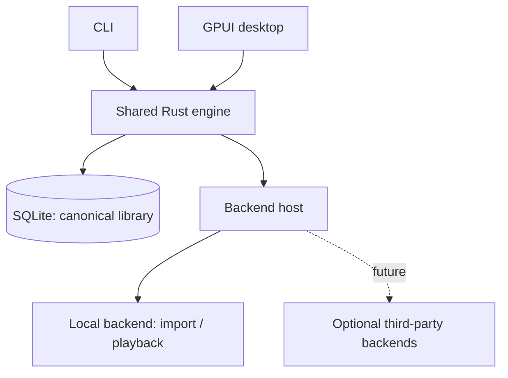
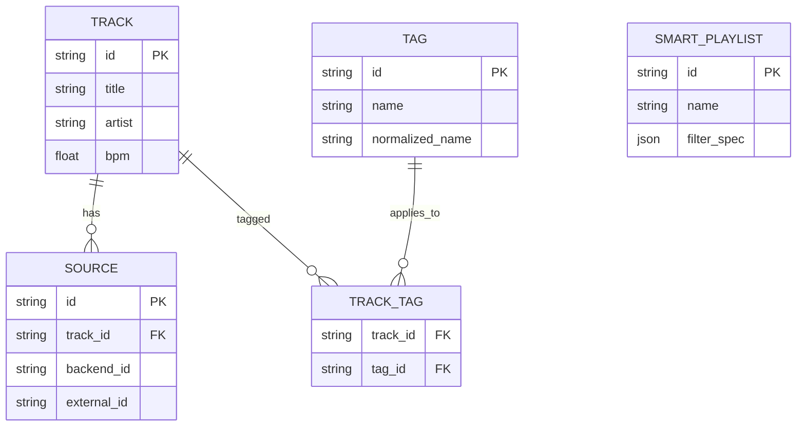

# Weave

**Rust · SQLite · GPUI**

## Goals

1. Play local music without accounts or network access.
2. Manage custom tags and source-neutral metadata.
3. Create dynamic playlists from structured filters.
4. Expose the same features through a CLI and GPUI desktop application.
5. Support capability-based backends, including optional third-party plugins in the future.

## Features and CLI

| Feature               | CLI                                                                                     | Behavior                                                                                                                           |
| --------------------- | --------------------------------------------------------------------------------------- | ---------------------------------------------------------------------------------------------------------------------------------- |
| Import music          | `weave-player import ~/Music`                                                           | Index audio files (recognized by content, not extension) without modifying them; prevent duplicate imports.                        |
| List tracks           | `weave-player list [--page N --limit N \| --all]`                                       | Paged table (default 50) with column titles, metadata and tags; `--json` for structured output. A track's ID is its readable slug. |
| Play                  | `weave-player play <track-id>`                                                          | Play an available local source.                                                                                                    |
| Playback controls     | `weave-player pause`, `weave-player resume`, `weave-player next`                        | Control the active playback session.                                                                                               |
| Current track         | `weave-player now`                                                                      | Show playback state and track details.                                                                                             |
| Add tags              | `weave-player add --tag bachata`                                                        | Tag the current track.                                                                                                             |
| Add tags to track     | `weave-player add <track-id> --tag bachata,90s`                                         | Add multiple tags, without duplicates.                                                                                             |
| Remove tags           | `weave-player remove <track-id> --tag bachata`                                          | Remove tag associations.                                                                                                           |
| Show tags             | `weave-player tags <track-id>`                                                          | List a track's custom tags.                                                                                                        |
| Match all tags        | `weave-player search --tag-all bachata,90s`                                             | Require every tag.                                                                                                                 |
| Match any tags        | `weave-player search --tag-any bachata,zouk`                                            | Require at least one tag.                                                                                                          |
| Exclude tags          | `weave-player search --tag-none remix,live`                                             | Exclude tracks with any specified tag.                                                                                             |
| BPM range             | `weave-player search --bpm-min 90 --bpm-max 140`                                        | Inclusive bounds; unknown BPM does not match.                                                                                      |
| Combined filters      | `weave-player search --tag-all bachata --tag-none live --bpm-min 90`                    | Apply every provided filter group.                                                                                                 |
| Metadata search       | `weave-player search --artist "Romeo Santos" --year-min 1990`                           | Filter by indexed metadata (title, artist, album, genre, year). Results are paged like `list`.                                     |
| Create smart playlist | `weave-player playlist create "Bachata 90s" --description "Slow" --tag-all bachata,90s` | Save filters, not track membership.                                                                                                |
| Show playlist         | `weave-player playlist show "Bachata 90s"`                                              | Evaluate its saved filters.                                                                                                        |
| Update playlist       | `weave-player playlist update "Bachata 90s" --bpm-min 90`                               | Change specified filters; retain others.                                                                                           |
| Play playlist         | `weave-player playlist play "Bachata 90s"`                                              | Queue current matching tracks.                                                                                                     |
| List playlists        | `weave-player playlist list`                                                            | Table of NAME, DESCRIPTION, TYPE (`dynamic`; manual playlists do not exist yet) and RULESET.                                       |
| List backends         | `weave-player backend list`                                                             | Show registered backends and capabilities.                                                                                         |
| Inspect backend       | `weave-player backend show local`                                                       | Show capabilities and availability.                                                                                                |

### Filter conventions

- `--tag-all a,b`: all listed tags must match.
- `--tag-any a,b`: at least one must match.
- `--tag-none a,b`: none may match.
- `--bpm-min N` / `--bpm-max N`, `--year-min N` / `--year-max N`: inclusive ranges.
- Different filter groups combine implicitly with AND; omitted groups do not restrict results.
- Reject invalid range bounds and use parameterized SQL
- Tags match case-insensitively, preserving display spelling.
- Filters use structured parameters, not a user-facing expression language.
- CLI and GPUI use the same serializable filter specification.

CLI Example:

```bash
weave-player search --tag-all bachata,sensual \
  --tag-any romantic,melodic \
  --tag-none live,remix \
  --bpm-min 90 --bpm-max 140
```

## Technical design

### Architecture



- The engine owns track identity, tags, filters, playlists, and metadata overrides.
- Frontends call the engine API; they never directly modify its database.
- Start in-process. Add IPC only when concurrent clients or shared playback require it.
- Local files are never rewritten, moved, or deleted without explicit permission.

### Data model



- A track's identity is independent of filesystem paths and service IDs.
- A track's public ID is a stable, readable slug `artist[-album]-title-source` (e.g. `romeo-santos-propuesta-indecente-local`), assigned at import (the opaque internal key is never shown) and unique (`-2`, `-3` on collision). Lowercase letters/digits of any script and `-` only; apostrophes dropped, `&` → `and`, any other character run → `-`; segments capped at 48 chars; unknown artist → `unknown`, empty title → `untitled`, album omitted when absent; `source` is the first source's backend ID. Metadata edits do not change it. Lookups normalize their input the same way.
- Descriptive metadata (title, artist, album, album artist, genre, composer, year, track/disc number, duration, BPM) lives in an indexed `TRACK_METADATA` table (one row per track, with lowercased copies for filtering and ordering); `TRACK` holds identity only.
- A track may have multiple sources.
- Smart playlists persist filters and resolve membership on demand.
- Until 0.1 the schema is a single squashed migration; older databases are rejected (delete and re-import). After 0.1 migrations are append-only.
- Use migrations, transactions, and indexes for tags and source mappings.

### Backend contract

```rust
pub trait Backend: Send + Sync {
    fn id(&self) -> &str;
    fn capabilities(&self) -> Vec<CapabilityDescriptor>;
}
```

| Capability group | Examples                 |
| ---------------- | ------------------------ |
| Catalog          | Search, browse           |
| Library          | Read, write, synchronize |
| Metadata         | Read, enrich             |
| Playback         | Stream, control          |
| Playlists        | Read, write              |
| Assets           | Lyrics, artwork          |

- Each advertised capability has separately typed operations.
- Track _supported_, _authorized_, and _currently available_ capabilities.
- Backends cannot modify canonical SQLite tables directly.
- The bundled `local` backend uses the same contract as future external backends.
- Begin with registered Rust implementations; defer WASM/native ABI/subprocess plugin decisions.

### Workspace

```text
weave/
├── crates/
│   ├── core/           # Types, filters, backend contracts
│   ├── engine/         # Library, playlists, playback orchestration
│   └── storage/        # SQLite, migrations
├── backends/
│   └── local/          # File import and playback
├── apps/
│   ├── cli/
│   └── desktop/        # GPUI
└── docs/
    ├── goals.md
    ├── agents.md
    └── credits.md
```

## Milestones

| Phase | Deliverable                                                                                |
| ----- | ------------------------------------------------------------------------------------------ |
| 0.a1  | SQLite library, local import, tags, filters, CLI                                           |
| 0.a2  | Local playback, queue, saved dynamic playlists, load and track synchronised lyrics         |
| 0.a3  | Second backend, capability discovery, external plugin contract                             |
| 0.a4  | Jellyfin integration - playback, playlist sync, save song source to source-neutral library |
| 0.1   | Spotify integration - playback, playlist sync, save song source to source-neutral library  |
| 0.2   | GPUI library browser, tag editor, smart playlist builder                                   |

## Non-goals for MVP

Cloud accounts, public tag sharing, file rewriting, a general-purpose query DSL, and mandatory background services.

See [CONTRIBUTING.md](CONTRIBUTING.md) to build and run it locally, and [credits.md](credits.md).
